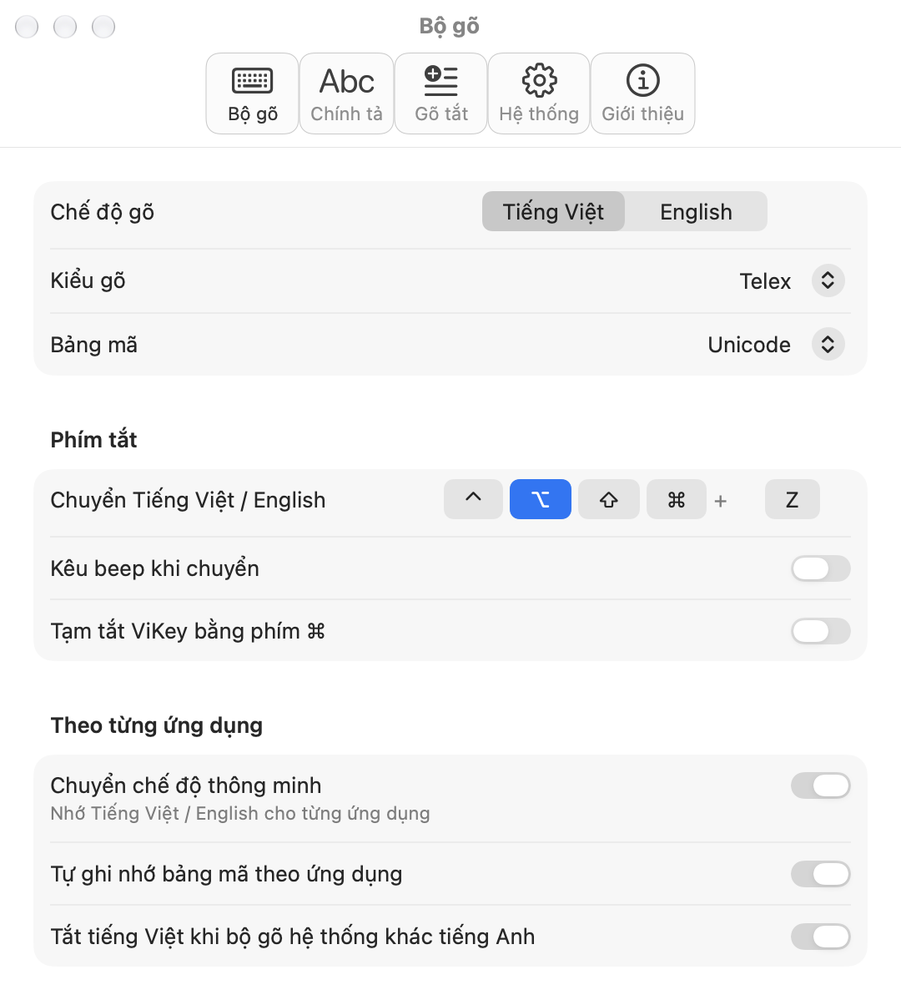
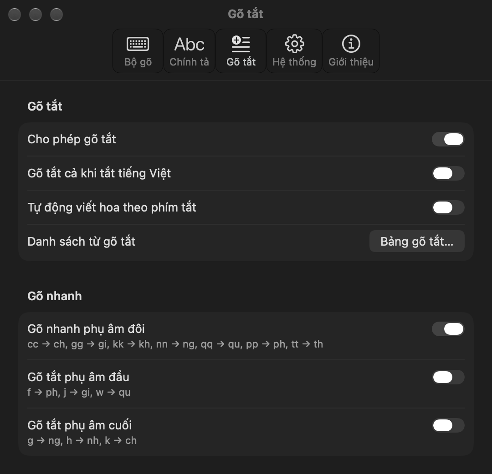

# ViKey

### [Tải bản mới nhất](https://github.com/hkvn/ViKey/releases/latest)

**Bộ gõ Tiếng Việt nguồn mở cho macOS**, phát triển tiếp từ [OpenKey](https://github.com/tuyenvm/OpenKey) của Mai Vũ Tuyên.
ViKey dùng kỹ thuật `Backspace`, không bị lỗi gạch chân như bộ gõ mặc định của macOS. Hoàn toàn miễn phí và là nguồn mở theo giấy phép GPL-3.0.

> **Lưu ý:** khi dùng ViKey, hãy tắt hẳn bộ gõ khác (kể cả OpenKey), vì hai bộ gõ chạy cùng lúc sẽ gõ sai.

  
  

## Điểm mới so với OpenKey
- Cửa sổ cài đặt mới theo phong cách System Settings của macOS, hỗ trợ giao diện sáng / tối.
- Báo cho bạn biết khi một ứng dụng bật **Secure Input** làm bộ gõ không gõ được, và cách khắc phục.
- Kiểm tra bản mới qua GitHub Releases của ViKey.
- Khởi động cùng macOS hoạt động trở lại (dùng SMAppService, không cần ứng dụng phụ).
- Tự chép cài đặt (gõ tắt, phím tắt, tuỳ chọn) từ OpenKey ở lần chạy đầu.
- Sửa nhiều lỗi: chuyển mã ký tự cuối, chữ hoa khi chuyển mã, chính tả "uych", gõ trong Spotlight, bộ gõ bị tắt sau khi chuyển mã nhanh,...

## Tính năng
**Kiểu gõ:** Telex, VNI, Simple Telex 1, Simple Telex 2.

**Bảng mã:** Unicode dựng sẵn, TCVN3 (ABC), VNI Windows, Unicode tổ hợp, Vietnamese Locale CP 1258.

**Bộ gõ**
- Phím tắt chuyển Tiếng Việt / English tuỳ chọn (⌃ ⌥ ⇧ ⌘ + một phím), có thể kêu beep khi chuyển.
- Tạm tắt ViKey bằng phím ⌘.
- Chuyển chế độ thông minh: nhớ Tiếng Việt / English cho từng ứng dụng.
- Tự ghi nhớ bảng mã theo ứng dụng, hợp với Photoshop, CAD,... dùng VNI hoặc TCVN3.
- Tự tắt tiếng Việt khi bộ gõ hệ thống không phải tiếng Anh.

**Chính tả**
- Kiểm tra chính tả, tự khôi phục phím khi từ không phải tiếng Việt.
- Cho phép "z w j f" làm phụ âm, tạm tắt chính tả bằng phím ⌃.
- Đặt dấu kiểu mới (oà, uý) hoặc kiểu cũ (òa, úy).
- Viết hoa chữ cái đầu câu.

**Gõ tắt**
- Gõ tắt không giới hạn độ dài (gõ tắt của macOS chỉ tới 20 ký tự), nhập / xuất danh sách ra file.
- Dùng gõ tắt cả khi tắt tiếng Việt, tự viết hoa theo phím tắt.
- Gõ nhanh phụ âm đôi: cc → ch, gg → gi, kk → kh, nn → ng, qq → qu, pp → ph, tt → th.
- Gõ tắt phụ âm đầu (f → ph, j → gi, w → qu) và phụ âm cuối (g → ng, h → nh, k → ch).

**Hệ thống**
- Khởi động cùng macOS, biểu tượng đơn sắc trên thanh menu, hiện biểu tượng trên Dock.
- Sửa lỗi gợi ý trên trình duyệt và Excel, sửa lỗi trên Chromium (beta).
- Chế độ "Gửi từng phím" cho ứng dụng không tương thích.
- Tương thích Telex trên layout khác (Dvorak, Colemak,...).

**Công cụ chuyển mã:** chuyển văn bản trong clipboard giữa các bảng mã (ví dụ VNI, TCVN3 sang Unicode), có phím tắt chuyển mã nhanh.

## Cài đặt
1. Tải file `ViKey-x.y.z.dmg` mới nhất từ [trang phát hành](https://github.com/hkvn/ViKey/releases/latest), mở ra và kéo `ViKey.app` vào thư mục Applications.
2. Lần đầu mở, nếu macOS chặn ứng dụng: vào *System Settings → Privacy & Security*, bấm **Open Anyway**. (ViKey được ký số nhưng chưa được Apple notarize.)
3. ViKey cần quyền Accessibility: vào *System Settings → Privacy & Security → Accessibility* và bật `ViKey`. **Không tắt quyền này khi đang dùng ViKey.**

Nếu bạn chuyển từ OpenKey sang: ViKey tự chép cài đặt của OpenKey ở lần chạy đầu và đề nghị thoát OpenKey nếu nó đang chạy.

## Cập nhật
ViKey kiểm tra bản mới mỗi khi khởi động (tắt được trong *Cài đặt → Hệ thống*), hoặc khi bạn bấm **Kiểm tra bản mới…** trong tab *Giới thiệu*. Khi có bản mới, bấm **Tải về** để mở trang phát hành, tải file `dmg` và thay `ViKey.app` cũ trong Applications. Các bản phát hành được ký cùng một chứng chỉ, nên bạn không phải cấp lại quyền Accessibility.

Danh sách các phiên bản: [Releases](https://github.com/hkvn/ViKey/releases) · [Changelog của OpenKey](https://github.com/tuyenvm/OpenKey/blob/master/CHANGELOG.md)

## Không gõ được tiếng Việt?
- **Biểu tượng ổ khoá trên thanh menu:** một ứng dụng đang bật Secure Input (ô mật khẩu, "Secure Keyboard Entry" của Terminal / iTerm,...). Bấm vào biểu tượng ViKey để xem ứng dụng nào và cách khắc phục.
- **Mất quyền Accessibility:** vào *System Settings → Privacy & Security → Accessibility*, xoá `ViKey` bằng nút "−", rồi mở lại ViKey để cấp quyền.
- **Bộ gõ khác đang chạy:** tắt các bộ gõ tiếng Việt khác.

## Phát triển
- Build từ mã nguồn và tạo bản phát hành: xem [macOS_Build.md](macOS_Build.md).
- Mã nguồn bản Windows và Linux của OpenKey vẫn nằm trong thư mục `Sources/OpenKey`, nhưng ViKey hiện chỉ phát triển bản macOS.

## Giấy phép
ViKey là phần mềm nguồn mở theo giấy phép [GPL-3.0](LICENSE), phát triển tiếp từ OpenKey © Mai Vũ Tuyên. Nếu bạn phân phối lại bản sửa đổi, bản đó cũng phải là nguồn mở và ghi rõ nguồn gốc.

## Tác giả OpenKey
- Mai Vũ Tuyên - maivutuyen.91@gmail.com
- Fanpage: [https://www.facebook.com/OpenKeyVN](https://www.facebook.com/OpenKeyVN)
- Ủng hộ tác giả OpenKey: [Buy me a coffee](https://tuyenvm.github.io/donate.html) · [PayPal](https://paypal.me/tuyenmai)
